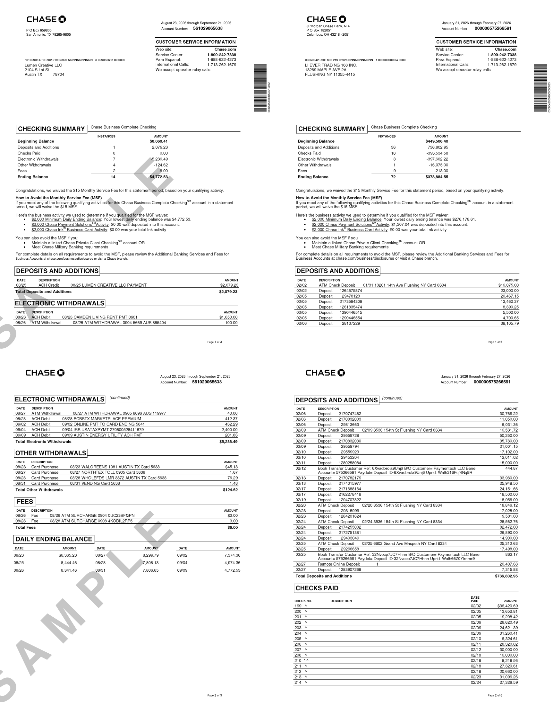
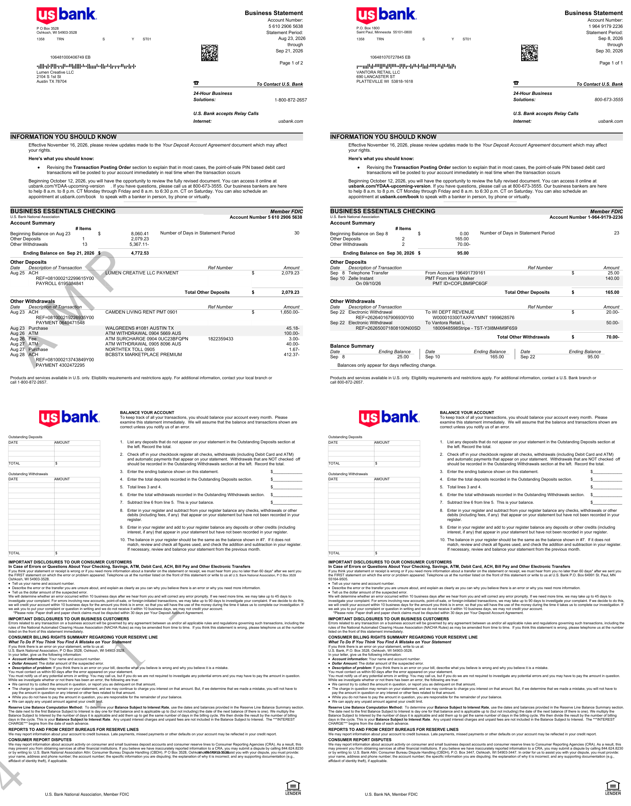

# 端到端对比：出片 vs 参考件

- 账本期数：2 份
- 水印：开

## boa-business

无参考 PDF，改用 layout json 做结构比对（13 段文字）

- 版式漂移：0 段（容差 2.5pt）
- 页数：5；墨量：[14.0, 13.3, 12.4, 5.5, 6.0]；字体：Connections PDF Rebuilt Regular, ConnectionsBold_CZEX0AA0, ConnectionsIta_CZEX0AC0, Connections_CZEX0A60, Connections_Me

## chase-business

参考件：`src/billgen/themes/chase/assets/chase_static_business.pdf`（6p，612.0×792.0）

| 方面 | 出片 | 参考件 | 判定 |
| --- | --- | --- | --- |
| 页面尺寸 | (612.0, 792.0) | (612.0, 792.0) | OK |
| 页数 | 3 | 6 | INFO |
| 字体（共有） | F10, F11, F12, F14, F2, F3, F4, F5, F6, F8, F9, Helvetica, Helvetica-Bold, Symbo | 参考共 15 种 | OK |
| 字体（仅出片） | 无 | — | INFO |
| 最低图效 DPI | 600.0 | 600.0 | OK |
| 第 1 页墨量 % | 12.7 | 12.4 | OK |
| 区块标题 CHECKING SUMMARY | 有 | 有 | OK |
| 区块标题 DEPOSITS AND ADDITIONS | 有 | 有 | OK |
| 参考件身份/占位泄漏 | 无 | — | OK |
| 日期格式 | MM/DD, Month D, YYYY | MM/DD, Month D, YYYY | OK |

差异：0 项

## usbank-business

参考件：`src/billgen/themes/usbank/assets/usbiz_static.pdf`（2p，612.0×792.0）

| 方面 | 出片 | 参考件 | 判定 |
| --- | --- | --- | --- |
| 页面尺寸 | (612.0, 792.0) | (612.0, 792.0) | OK |
| 页数 | 4 | 2 | INFO |
| 字体（共有） | Arial-BoldItalicMT, Arial-BoldMT, Arial-ItalicMT, ArialMT, C0000365_T1001140_0,  | 参考共 9 种 | OK |
| 字体（仅出片） | Helvetica | — | INFO |
| 最低图效 DPI | 240.4 | 240.4 | OK |
| 第 1 页墨量 % | 16.4 | 18.3 | OK |
| 区块标题 Business Statement | 有 | 有 | OK |
| 区块标题 BUSINESS ESSENTIALS CHECKING | 有 | 有 | OK |
| 区块标题 Account Summary | 有 | 有 | OK |
| 参考件身份/占位泄漏 | 无 | — | OK |
| 日期格式 | Mon D, Mon DD, YYYY, Month D, YYYY | MM/DD, Mon D, Mon DD, YYYY, Month D, YYYY | OK |

差异：0 项

