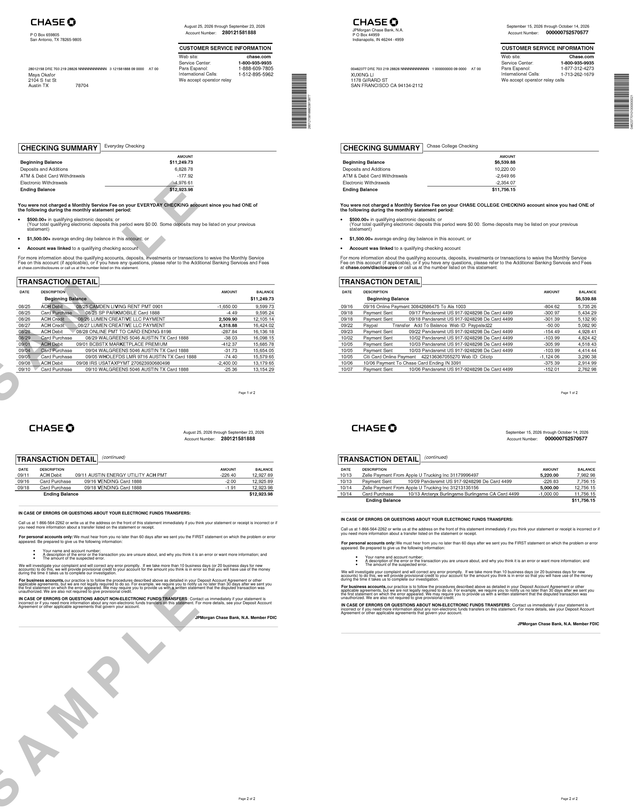
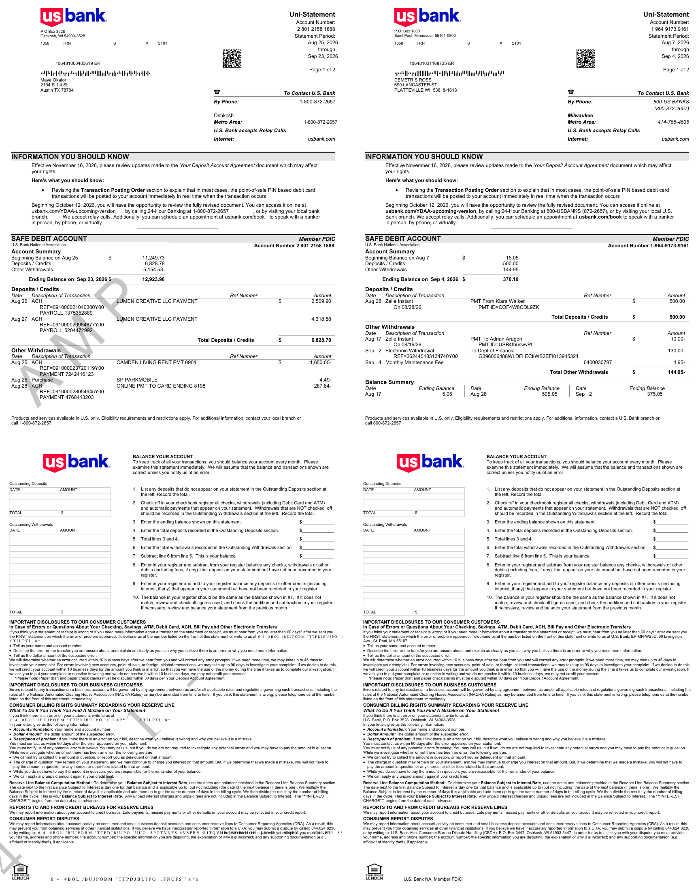
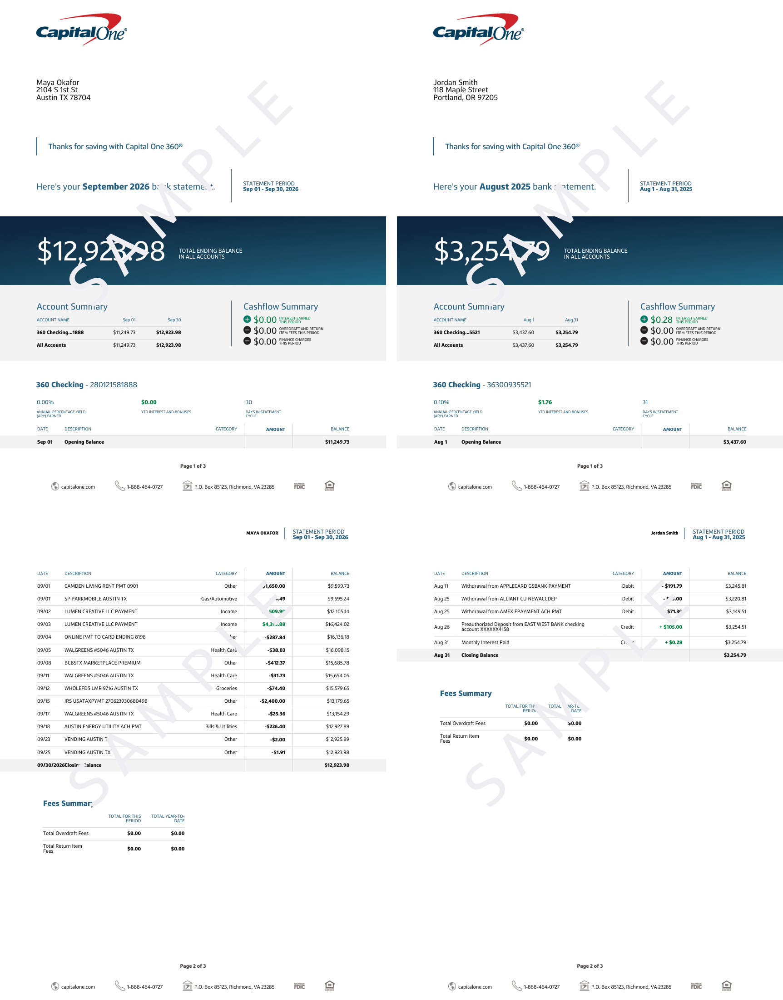
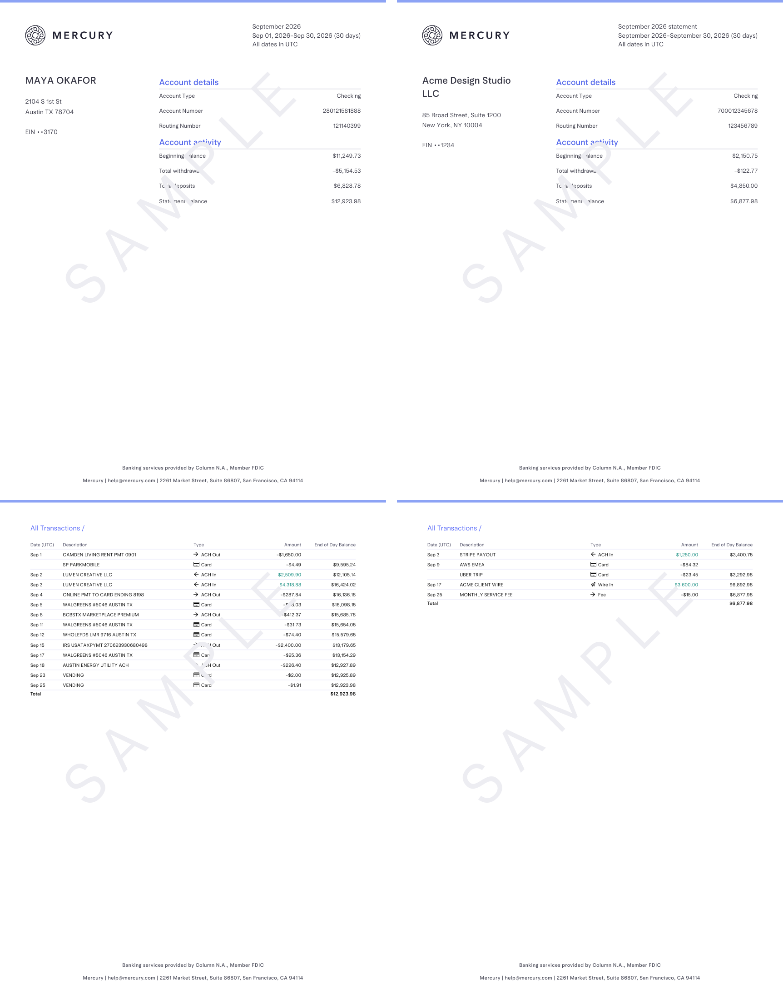
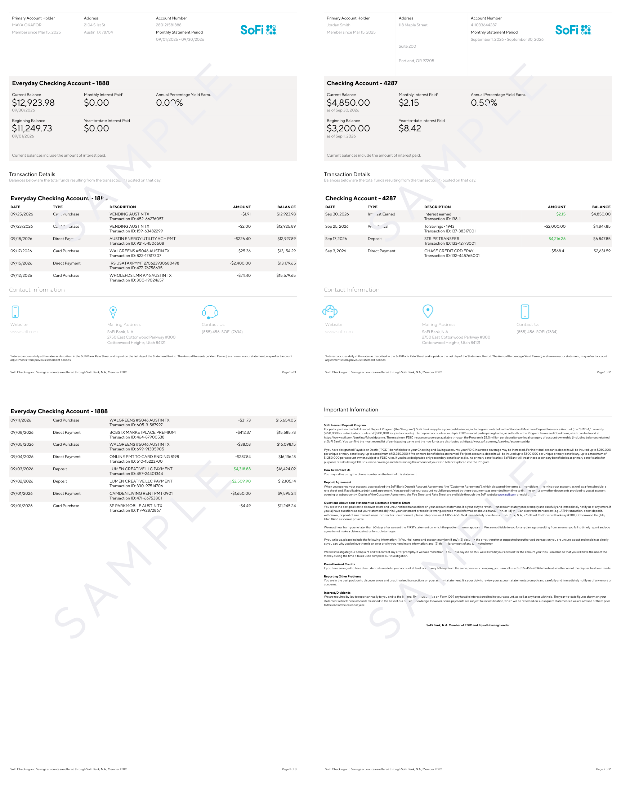

# 端到端对比：出片 vs 参考件

- 账本期数：2 份
- 水印：开

## boa-personal

无参考 PDF，改用 layout json 做结构比对（23 段文字）

- 版式漂移：0 段（容差 2.5pt）
- 页数：5；墨量：[7.7, 13.2, 11.0, 1.0, 3.8]；字体：Connections PDF Rebuilt Regular, ConnectionsBold_CZEX0AA0, ConnectionsIta_CZEX0AC0, Connections_CZEX0A60, Connections_Me

## boa-business

跳过：`结果包里没有账户 'business_checking'，现有：['checking', 'credit']`

## chase-personal

参考件：`src/billgen/themes/chase/assets/chase_static_personal.pdf`（2p，612.0×792.0）

| 方面 | 出片 | 参考件 | 判定 |
| --- | --- | --- | --- |
| 页面尺寸 | (612.0, 792.0) | (612.0, 792.0) | OK |
| 页数 | 2 | 2 | OK |
| 字体（共有） | F10, F11, F12, F15, F2, F3, F4, F5, F6, F8, F9, Helvetica, Helvetica-Bold, Symbo | 参考共 15 种 | OK |
| 字体（仅出片） | 无 | — | INFO |
| 最低图效 DPI | 600.0 | 600.0 | OK |
| 第 1 页墨量 % | 15.4 | 13.9 | OK |
| 区块标题 CHECKING SUMMARY | 有 | 有 | OK |
| 区块标题 CUSTOMER SERVICE INFORMATION | 有 | 有 | OK |
| 区块标题 TRANSACTION DETAIL | 有 | 有 | OK |
| 参考件身份/占位泄漏 | 无 | — | OK |
| 日期格式 | MM/DD, Month D, YYYY | MM/DD, Month D, YYYY | OK |

差异：0 项

## chase-business

跳过：`结果包里没有账户 'business_checking'，现有：['checking', 'credit']`

## usbank-personal

参考件：`src/billgen/themes/usbank/assets/us_static_personal.pdf`（4p，612.0×792.0）

| 方面 | 出片 | 参考件 | 判定 |
| --- | --- | --- | --- |
| 页面尺寸 | (612.0, 792.0) | (612.0, 792.0) | OK |
| 页数 | 4 | 4 | OK |
| 字体（共有） | Arial-BoldItalicMT, Arial-BoldMT, Arial-ItalicMT, ArialMT, C0000365_T1001140_0,  | 参考共 9 种 | OK |
| 字体（仅出片） | 无 | — | INFO |
| 最低图效 DPI | 240.4 | 240.4 | OK |
| 第 1 页墨量 % | 13.7 | 13.3 | OK |
| 区块标题 Uni-Statement | 有 | 有 | OK |
| 区块标题 SAFE DEBIT ACCOUNT | 有 | 有 | OK |
| 区块标题 Account Summary | 有 | 有 | OK |
| 区块标题 Deposits / Credits | 有 | 有 | OK |
| 区块标题 Other Withdrawals | 有 | 有 | OK |
| 参考件身份/占位泄漏 | 无 | — | OK |
| 日期格式 | Mon D, Mon DD, YYYY, Month D, YYYY | MM/DD, Mon D, Month D, YYYY | OK |

差异：0 项

## usbank-business

跳过：`usbank-business 账本自检未通过（1 项）：account_mismatch: usbank-business 只接受 ['business_checking']，账本是 checking`

## capitalone

参考件：`src/billgen/themes/capitalone/C1-Personal-Statement-SAMPLE.pdf`（3p，612.0×792.0）

| 方面 | 出片 | 参考件 | 判定 |
| --- | --- | --- | --- |
| 页面尺寸 | (612.0, 792.0) | (612.0, 792.0) | OK |
| 页数 | 3 | 3 | OK |
| 字体（共有） | MyFontBold, MyFontRegular | 参考共 3 种 | OK |
| 字体（仅出片） | MyFontMedium | — | INFO |
| 最低图效 DPI | 72.0 | 72.0 | OK |
| 第 1 页墨量 % | 34.5 | 34.5 | OK |
| 区块标题 TOTAL ENDING BALANCE | 有 | 有 | OK |
| 区块标题 Account Summary | 有 | 有 | OK |
| 区块标题 Cashflow Summary | 有 | 有 | OK |
| 参考件身份/占位泄漏 | 无 | — | OK |
| 日期格式 | MM/DD, Mon D, Mon DD, YYYY | Mon D, Mon DD, YYYY | OK |

差异：0 项

## mercury

参考件：`src/billgen/themes/mercury/Demo-Bank-Statement-SAMPLE.pdf`（2p，612.0×792.0）

| 方面 | 出片 | 参考件 | 判定 |
| --- | --- | --- | --- |
| 页面尺寸 | (612.0, 792.0) | (612.0, 792.0) | OK |
| 页数 | 2 | 2 | OK |
| 字体（共有） | 1695149660304911865-0-Arcadia-Text-480, ArcadiaText-480, ArcadiaTextVariable-Var | 参考共 4 种 | OK |
| 字体（仅出片） | 无 | — | INFO |
| 第 1 页墨量 % | 3.8 | 4.0 | OK |
| 区块标题 Account details | 有 | 有 | OK |
| 区块标题 Account activity | 有 | 有 | OK |
| 区块标题 All Transactions | 有 | 有 | OK |
| 参考件身份/占位泄漏 | 无 | — | OK |
| 日期格式 | Mon D, Mon DD, YYYY | Mon D, Month D, YYYY | OK |

差异：0 项

## sofi

参考件：`src/billgen/themes/sofi/SoFi-Statement-SAMPLE.pdf`（2p，612.0×792.0）

| 方面 | 出片 | 参考件 | 判定 |
| --- | --- | --- | --- |
| 页面尺寸 | (612.0, 792.0) | (612.0, 792.0) | OK |
| 页数 | 3 | 2 | INFO |
| 字体（共有） | Montserrat-Thin, TTNormsBold, TTNormsRegular | 参考共 3 种 | OK |
| 字体（仅出片） | 无 | — | INFO |
| 最低图效 DPI | 全矢量 | 78.6 | OK |
| 第 1 页墨量 % | 32.3 | 29.2 | OK |
| 区块标题 Primary Account Holder | 有 | 有 | OK |
| 区块标题 Transaction Details | 有 | 有 | OK |
| 区块标题 Contact Information | 有 | 有 | OK |
| 参考件身份/占位泄漏 | 无 | — | OK |
| 日期格式 | MM/DD, MM/DD/YYYY, Mon D, Mon DD, YYYY | Mon D, Mon DD, YYYY, Month D, YYYY | OK |

差异：0 项

## wellsfargo

无参考 PDF，改用 layout json 做结构比对（34 段文字）

- 版式漂移：0 段（容差 2.5pt）
- 页数：6；墨量：[7.8, 10.1, 6.3, 6.0, 9.7, 10.1]；字体：Helvetica, Helvetica-Bold, MyriadPro-Black, MyriadPro-Bold, MyriadPro-BoldIt, MyriadPro-It, MyriadPro-Regular, SymbolMT,

无参考件（无 PDF、无 layout json）：本轮只做自检指标与区块标题检查。

## amex

无参考件（无 PDF、无 layout 底稿）：本轮只做自检指标与区块标题检查。

- 页数：3；墨量：[8.0, 4.5, 5.0]；字体：BentonSans-Bold, BentonSans-Regular, BentonSans-RegularItalic, Helvetica

